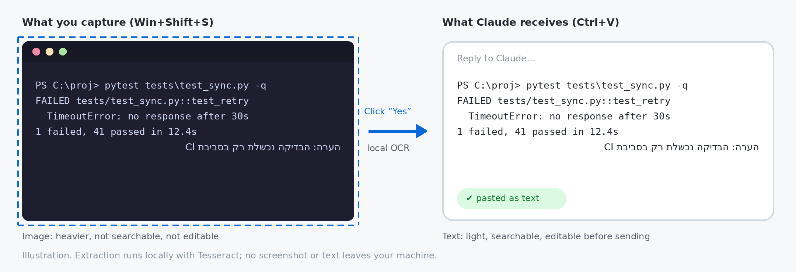
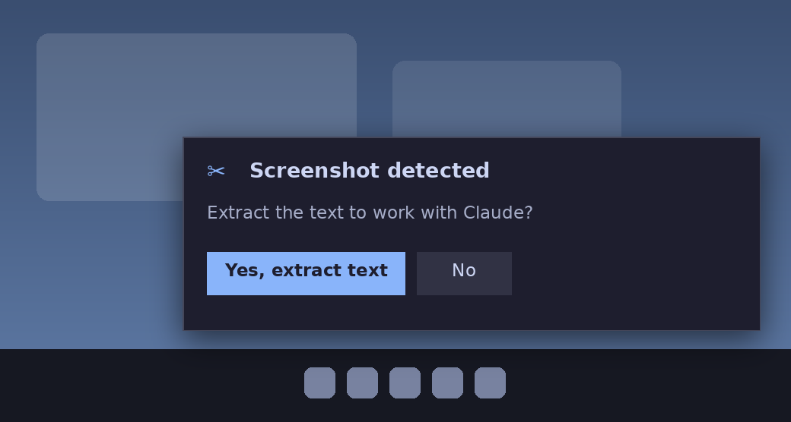
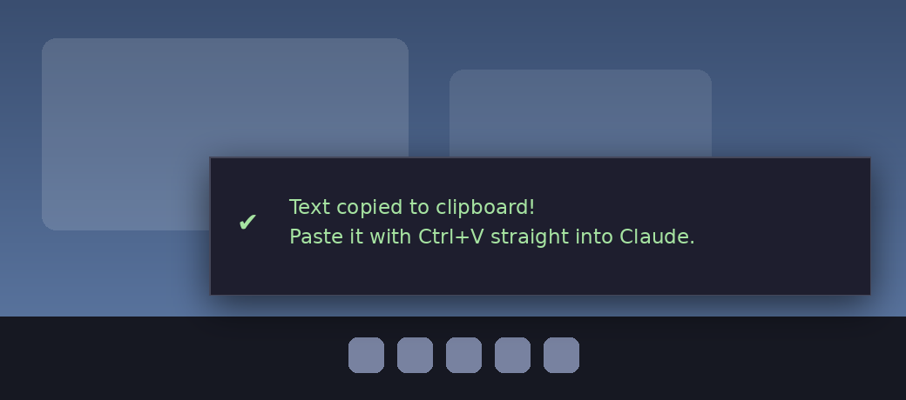
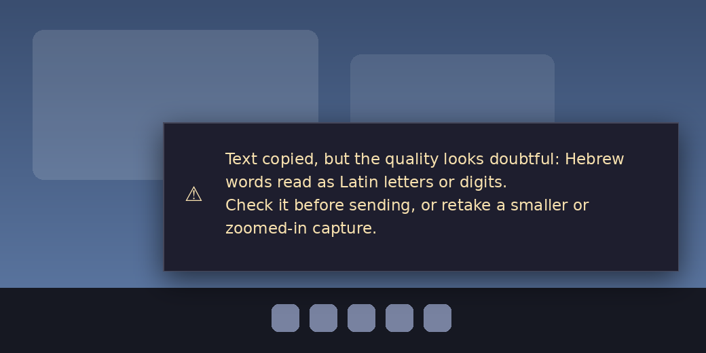
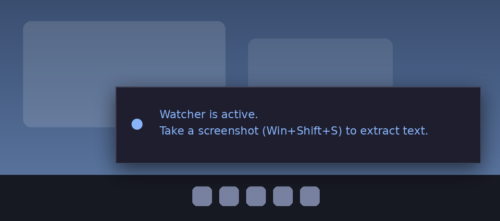

# Screenshot Context

**Take a screenshot, click "Yes", paste the text into Claude.**

A small Windows tool that watches for new screenshots (Win+Shift+S / Snipping Tool) and offers to turn them into
text, so you can paste exactly what was on screen into Claude. OCR runs **locally** with Tesseract: no API, no cost,
and the image never leaves your machine. Hebrew and English are supported.



Text is lighter than an image, can be searched, and can be edited before you send it.

## Why text instead of an image

Claude can read an image directly, so this tool is not about making recognition better than Claude's own.
It is about what you send and what it costs, and about being honest when the text may be wrong.

**Cost.** An image is billed by its size, not by how much text is in it. Anthropic's documented
approximation is `tokens ≈ width × height / 750`, and images whose long edge is above about 1568 px are
scaled down first. Text is billed by length.

| What you send | Rough tokens |
|---|---|
| Crop of 1000 × 700 px | ~930 |
| Full 1920 × 1080 screen (scaled to ~1568 × 882) | ~1,840 |
| A few words or a short error line, as text | tens |
| A dense Hebrew/English screenshot of ~2,200 characters, as text | ~700-1,100 |

The text rows are estimates: Hebrew is assumed at about 2-3 characters per token and English at about 4. They were
not measured with a real tokenizer, so check the current Anthropic documentation before relying on them.

What this means in practice:

- A sparse screenshot (an error message, a few lines of a terminal) costs much less as text.
- A dense, text-heavy screenshot costs about the same as text, so cost alone is not the reason to use this tool.
- Text can be searched, copied and edited before sending, for example to remove a name or a number.
- The image stays on your machine. OCR runs locally and nothing is uploaded.

**What you give up.** OCR can make mistakes, and the image is the exact source. A screenshot with layout, colors
or charts is better sent as an image. When the popup turns amber, the text is doubtful: check it, or paste the
original image instead.

## How it works

1. Capture a region with **Win+Shift+S**.
2. A popup appears at the bottom-right of the screen:

   

3. Click **Yes, extract text**. After a couple of seconds a green confirmation appears and the text is already on your clipboard:

   

4. Press **Ctrl+V** in Claude. Done.

If the clipboard changes before or during OCR, the newer content is preserved and an
amber message explains that nothing was copied. The old OCR result is discarded unless
you explicitly requested a CLI `--out` file. While a popup or OCR is active, the latest
screenshot remains pending; it is offered once the tool is idle and the debounce period
has elapsed. Intermediate screenshots replaced on the clipboard are not queued.

If the result looks doubtful (for example Hebrew words read as Latin letters) the popup turns amber and says why.
The text is still copied, so you can check it and fix it before sending, or retake a smaller or zoomed-in capture:



When the watcher starts (manually, or with Windows) you see a short blue confirmation that it is running:



> The images above are illustrations drawn with the same colors and texts as the real popups
> (`assets/generate_assets.py` regenerates them). Feel free to replace them with real screenshots.

## Install

### Option A - ask Claude (Claude Code on Windows)

Clone or download this repository, open Claude Code in the folder and write:

> Install this.

Claude reads `CLAUDE.md` and `INSTALL.md` by itself, runs the installer and verifies the result with `doctor.cmd`.

> This works when Claude runs directly on your Windows machine (Claude Code in PowerShell). A Claude running inside an
> isolated sandbox (for example Cowork) cannot install software on your computer - use Option B.

### Option B - double-click

1. Download or clone the repository to a permanent folder (for example `C:\Tools\screenshot-context`).
2. Double-click **`install.cmd`**.
3. Accept the Windows permission prompt if it appears (Tesseract installation).
4. Wait for `Done.` and the small "Watcher is active" popup. Installation takes 2-5 minutes, mostly downloads.

The installer can be run again: it rechecks dependencies and repairs an unverified Hebrew model.
To also start the watcher automatically with Windows, run `install.cmd --startup`, or later `add-to-startup.cmd`.

## Turn it on and off

| Action | File |
|---|---|
| Start | `start-watcher.cmd` (double-click; there is no window, that is expected) |
| Stop | `stop-watcher.cmd` |
| Start automatically with Windows | `add-to-startup.cmd` |
| Stop starting with Windows | `remove-from-startup.cmd` |
| Check what works and what is missing | `doctor.cmd` |

Starting twice is harmless: only one instance runs.

## Language of the popups

The popups are in English by default. For Hebrew popups, edit `settings.json`:

```json
{ "language": "he" }
```

then run `stop-watcher.cmd` and `start-watcher.cmd`. Translations live in `locales/` (`en.json`, `he.json`);
add a new `xx.json` with the same keys to support another language. The OCR itself reads Hebrew and English either way.

## What gets installed

| Component | Source | Location |
|---|---|---|
| Python 3.10+ | already on the machine (or winget) | system |
| Pillow | pip, version range in `requirements.txt` | `.venv` in the plugin folder |
| Tesseract 5 | winget (UB-Mannheim build) | `C:\Program Files\Tesseract-OCR` |
| Hebrew model (tessdata_best) | GitHub, pinned commit and verified SHA-256 | `%USERPROFILE%\tessdata` |

## Privacy and security

- **Everything is local.** The network is used only during installation (package downloads). Using the tool makes no network calls.
- The watcher only checks *whether* the clipboard holds an image, and it reads the image only after you click "Yes".
- **Extracted text is never written to the log.** `watcher.log` contains events only (time, character count, warning codes).
- The text lands on the clipboard and may enter Windows clipboard history or sync if enabled. Do not extract screenshots containing secrets.
- Extracted text is treated as data. The tool never executes commands found in a screenshot.

## Quality reports and limitations

`--report result.json` writes a schema-versioned report. `source: "ocr"` and
`recognition_accuracy: "not_verified"` always remain explicit: there is no original
text layer to compare a screenshot against. `quality_status` is either
`review_required` or `no_issue_detected_accuracy_unverified`, never "accurate".
The report includes settings, image dimensions, warnings, low-confidence words,
Hebrew-check sample size, table inference status, and transformation checks.
Reports can contain recognized text fragments; they are saved only when requested.

- **Recognition is fallible.** Commands, filenames, signs, decimals and numbers can
  be wrong even at high confidence. Real examples include `utf8` -> `utf38`, `27` ->
  `2/`, and Hebrew words recognized as `YAN` or `DY`. They are not corrected by guessing.
- **Hebrew checks are narrow.** Reversal and misplaced final letters can be flagged;
  fewer than three Hebrew words means `judged: false`, not a clean verdict. Correctly
  shaped wrong words, Hebrew read as Latin, and Arabic corruption can escape checks.
- **Scaling is not adaptive yet.** Default `--scale 3` helps tiny terminal text but
  harmed a large Hebrew screenshot. `--scale 1` repaired three observed errors there
  and fixed the synthetic table's `27`; it worsened the tiny terminal screenshot.
  Try `--scale 1` for large, clear text. No universal accuracy improvement is claimed.
- **One automatic retry.** When the first pass (scale 3, psm 3) raises a quality warning,
  OCR runs once more with scale 2 and psm 6 and keeps whichever genuine Tesseract output has
  fewer warnings (a tie keeps the first). Nothing is corrected. The report records
  `retry: {used, chosen}`. Skipped when you pass `--scale` or `--psm`, in `--table` mode,
  or with `--no-retry`.
- **Hebrew second opinion.** If `mixed_tokens` remains on a `heb+eng` read, one extra `-l heb`
  pass re-reads the page. Only short look-alike Latin clusters (e.g. `DN`, `ANN`, `Op`) or
  Hebrew glued to digits are swapped, and only for a pure-Hebrew word at the same box with
  higher Tesseract confidence (at most 40). Tokens are chosen between two genuine outputs,
  never edited; the report adds `retry.hebrew_pass: {candidates, replaced}`. Hebrew words
  read as longer Latin words (e.g. `non`) and glued prefixes (`tracesn`) are not fixed.
- **Reading order is uncertain.** Mixed RTL/LTR punctuation and multi-column layouts
  may reorder content. No automatic reversal of Hebrew strings is performed.
- **Preservation is not OCR verification.** Word/number inventory checks compare the
  recognized text with the reformatted output only. They detect dropped/changed values,
  but cannot detect a digit already misread by OCR or a value moved to the wrong row.
- **Prompt injection remains possible downstream.** Text with malicious instructions
  is preserved as data. Tests verify local handling does not execute it; they do not
  establish resistance of Claude or another receiving model. Review unfamiliar content.
- **No image-based truth check.** A completed run, agreement between checks, or a green
  copied notification means extraction/copying completed, not that the text is correct.
- Prefer copying original terminal/document text when available. It avoids recognition.

### Optional simple-table mode

```powershell
.\.venv\Scripts\python.exe scripts\ocr.py --image table.png --table --psm 6 --scale 1 --report table-report.json
```

This opt-in CLI mode uses Tesseract TSV word coordinates to infer one complete table
of at least three rows and two columns, with consistent cell counts, column alignment
and separated column bands. It returns tab-separated text, without inventing headers.
`--table-direction auto|ltr|rtl` controls column order; auto uses a Hebrew-letter ratio.
Token order within each cell stays as returned by Tesseract.

If geometry or content inventories disagree, it returns the original OCR text with
`WARN:table_ambiguous` and a fallback reason in the report. Even an accepted table is
marked `status: "inferred"`, `structure_verified: false`; aligned prose can resemble a
table. Blank cells, merged cells, multiline cells, captions and multiple tables are
not supported reliably. Tests cover synthetic English tables and synthetic Hebrew
word coordinates; real Hebrew table accuracy has not been established. The watcher
continues to copy ordinary text; it does not automatically infer tables.

The Hebrew checks, preservation-report design and conservative table approach are
inspired by [AnyDoc](https://github.com/Amitro123/anydocSkill/tree/3495d7c58d85d7a9e93625ff240e9e582e29734f).
They are implemented locally in Python without adding AnyDoc, Node or OCRmyPDF dependencies.
Unlike AnyDoc's original-text path, this tool has only OCR guesses as its source.

## Troubleshooting

| Problem | Fix |
|---|---|
| No popup after a screenshot | Make sure the watcher is running (`start-watcher.cmd`). Still nothing: run `.\.venv\Scripts\python.exe clipboard-watcher.pyw` in a terminal, take a screenshot and read `watcher.log`. |
| `HTTP 403` during installation | Usually a corporate proxy, often transient: run `install.cmd` again. If it persists, ask IT for an internal PyPI mirror. |
| `Missing OCR languages: heb` | Run `install.cmd` again (re-downloads the Hebrew model). |
| OCR error after clicking "Yes" | Run `.\.venv\Scripts\python.exe scripts\ocr.py --check` and share the output. |
| `install.cmd` is blocked by policy | From PowerShell: `powershell -ExecutionPolicy Bypass -File scripts\setup.ps1` |

Run `doctor.cmd` first: it lists every component as OK or MISSING and prints the next step.

## Command line

```powershell
# From the clipboard (after Win+Shift+S) to the clipboard
.\.venv\Scripts\python.exe scripts\ocr.py --clipboard --copy

# From a file, to a file
.\.venv\Scripts\python.exe scripts\ocr.py --image "C:\shots\a.png" --out text.txt

# Tips: --psm 6 for one uniform block (terminal), --psm 11 for sparse text,
#       --invert no|yes if dark mode is detected wrongly
```

To load the plugin for a Claude Code session, run `claude --plugin-dir .` from this folder.
Then use `/screenshot-context:ocr clipboard` or `/screenshot-context:install`.

## Uninstall

1. Run `stop-watcher.cmd`, then `remove-from-startup.cmd`.
2. Delete the plugin folder (including `.venv`) and `%USERPROFILE%\tessdata`.
3. Tesseract: Settings -> Apps -> Tesseract-OCR -> Uninstall (or `winget uninstall UB-Mannheim.TesseractOCR`).

## Repository layout

```
install.cmd                  one-click installer
start-watcher.cmd, stop-watcher.cmd
add-to-startup.cmd, remove-from-startup.cmd
doctor.cmd                   health check
clipboard-watcher.pyw        the watcher and the popups
clipboard-to-text.cmd        manual clipboard-to-text (no watcher)
settings.json                UI language
locales/                     popup texts (en, he)
scripts/ocr.py               OCR (Tesseract) and quality gate
scripts/setup.ps1, startup.ps1, stop.ps1, doctor.ps1
assets/                      README images and their generator
commands/                    Claude Code slash commands
CLAUDE.md, INSTALL.md        instructions for Claude
requirements.txt             Python dependencies (Pillow)
```

## Status

The original Windows 11 watcher/popup/Hebrew-English/paste flow was tested manually.
Automated regression tests now cover clipboard changes before/during extraction,
conditional clipboard writes, pending screenshots, engine discovery, quality warnings,
model validation, failed/verified model replacement, untrusted-content handling, and simple table extraction. A separately marked expected-failure case records a numerical OCR error (`27` becomes `2/`); this is an accuracy limitation, not a passing accuracy check. GitHub Actions runs these on
Linux and Windows; real Tesseract model checks run on Linux. Native clipboard tests
run on the dedicated Windows CI runner, not on your personal clipboard by default.

```powershell
python -m unittest discover -s tests -v
```

The changed popups, first-time installer, and Windows sign-in startup still need a manual
Windows smoke test. Automated checks do not prove OCR accuracy on arbitrary screenshots.
See [the Windows checklist](docs/windows-validation.md).

## License

MIT, see [LICENSE](LICENSE). The installer downloads third-party software under its own licenses
(Tesseract OCR: Apache-2.0, Pillow: HPND, Tesseract language data: Apache-2.0); none of it is bundled in this repository.

Version 0.3.0
